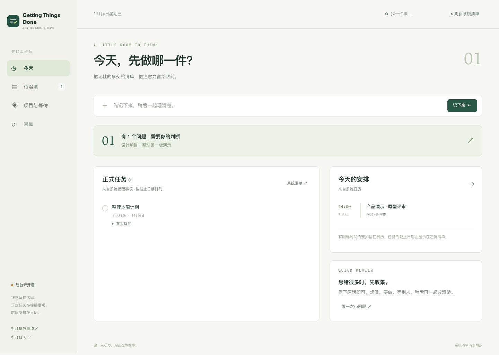

<p align="center">
  
</p>

<h1 align="center">Getting Things Done</h1>

A personal GTD companion for macOS: turn activity clues into a small clarification queue, then decide what belongs in your actual task list.

**Native WKWebView app · Codex skill · Apple Reminders & Calendar · pluggable clue sources**

The interface is currently in Chinese. This is an early preview built for local use.

**[Download v0.5.1](https://github.com/zgdllt/Getting-Things-Done/releases/tag/v0.5.1)** · [Build from source](#install-from-source)



*The screenshot uses synthetic demonstration data. No personal task lists or activity records are included in this repository.*

## The workflow

```text
clue source adapters → local candidates + source evidence
                    → memory summaries and related older clues
                    → questions that need your judgment
                    → batch clarification in the app or Codex
                    → preview and explicit confirmation
                    → Apple Reminders / Calendar
```

Observed activity is a clue. It does not automatically become a commitment, a deadline, or proof of completion.

| View | What it does |
| --- | --- |
| Today | Existing reminders, current/upcoming calendar events, quick capture, completion |
| Clarify | Candidate summaries, source excerpts, questions, saved answers, batch preview |
| Projects & Waiting | Confirmed projects and their linked system actions; active waiting items |
| Review | Unprocessed clues, unresolved questions, overdue actions, upcoming events and recent summaries |
| Files (current source update) | Selected workspaces, suggested Finder priority tags, preview, confirmed application and undo |

Notifications name the specific item and the question, and open the native app's clarification view. The app uses AppKit and the system WebKit engine. There is no bundled Chromium runtime, frontend framework, external font or CDN.

## Four-quadrant board data layer

The source also provides a deterministic, agent-maintained four-quadrant board data layer.
It joins project activity/memory, open candidates and the saved Apple task/calendar snapshot;
it does not call a model or change Apple records. This task adds no board UI or notification delivery.
Use an explicit isolated state directory while trying it:

```sh
cd scripts
python3 gtd_board.py --state /path/to/isolated-state build
python3 gtd_board.py --state /path/to/isolated-state show
python3 gtd_board.py --state /path/to/isolated-state feedback project:alpha move 2
python3 gtd_board.py --state /path/to/isolated-state notifications
```

`build` writes private `board.json`; feedback maintains private preferences and an append-only
evidence log. `notifications` previews eligible Q1 alerts and at most one ranked Q2 nudge.
Call `mark_notified` only for successfully delivered previews when a delivery layer is added.
Quiet hours default to local 22:00–09:00; configure `quiet_hours` as
`{"start":"22:00","end":"09:00"}` in the state configuration, or `false` to disable them.
See [board decisions and validation](references/verification.md#board-data-layer) for the exact
date, feedback, notification receipt and test semantics.

## Settings and immediate replies

In the current source version, **Settings** sits at the bottom left of the sidebar. It contains the task display style, model and reasoning selectors, background/notification status and system-app permission status. GTD defaults to **`gpt-6.1-terra` / `high`**. Choose from the local Codex model catalog or enter another model ID supported by your provider. Settings affect the next GTD model call and preserve your existing provider, login and ordinary Codex chat defaults.

**Settings → 模型供应商** switches history extraction, answer processing and quick options between Codex and any OpenAI-compatible endpoint: presets for DeepSeek, Qwen (DashScope), GLM and Kimi, a relay, or your own model through an SSH tunnel (`http` is accepted only for `127.0.0.1`/`localhost`). **获取可用模型** reads the endpoint's `GET /models`; **测试连接** sends one tiny JSON request and shows the result as a status dot. For local reasoning models, **关闭思考模式** and a maximum output length prevent runaway generation. Each provider is stored as a private file `~/.codex/personal-gtd/secrets/<id>.json` (mode 0600); keys are never sent back to the page. A blank key field keeps the stored key.

The current source defaults to **swipeable cards** across Today, Clarify, Projects & Waiting, and Review. Tasks, calendar events, standalone clarification questions, projects, waiting items, review steps and history entries use the same display setting; metrics and filters stay visible. Navigate with a horizontal touch/trackpad gesture, arrow buttons, or the left/right arrow keys while the deck is focused. Switching cards preserves answer drafts, selected candidates and review checks. Completing and confirming tasks use their explicit buttons. Choose **Settings → 待办展示 → 条目列表** to keep the original list layout; the preference persists across reloads. Completion, dismissal, saved answers and restore acknowledgements hold for **0.4 seconds**, then fade out over **0.3 seconds** while you continue interacting. Success toasts use the same timing.

A standalone, synthetic-data **Bilibili Toy demo** is available in [demos/toy](demos/toy/README.md). It runs without a local server API, Computer History, model calls or access to Apple apps; it shares the production card-navigation code.

**Save answers and organize** first saves the answers, then immediately starts a separate model job. It does not wait for the history backlog. Each card shows progress, a reply and revised next action, or a focused follow-up question. A clearly finished/dropped local candidate can be closed; formal Reminders are never completed by model inference. Failed jobs keep their answers and offer retry. Older saved answers have an **Organize using answers** action as well.

Each submitted answer batch can make an additional model call. Opening Settings, saving model preferences and browsing already-generated replies do not call a model. The v0.5.1 download includes these settings, immediate replies, source adapters, local history recall and swipeable cards.

## Finder tags for your files (current source update)

Open **资料** to start with deduplicated local **Codex project root folders**, then add other files or folders with the native picker. Each selected root is one item: children are never enumerated. The agent uses names, existing tags, project activity and confirmed task context; file and conversation bodies are not uploaded. Existing tags and file locations are preserved.

**Green means completed**, independently of Reminders completion. Initial editable mappings use red for important/urgent, yellow for important/not urgent, orange for urgent/less important, and gray for later. Open **Settings → 资料标签 → 颜色与程度设置** to map these categories to your existing Finder tags. The model cannot create new tag names.

Review each suggestion, select a batch, preview and explicitly confirm. The app reads back the saved native tags and provides per-file results. Undo removes only that operation's additions, retaining other tags added later; changed file identity or tag colors are reported for review. You can filter by tag, open a file or reveal it in Finder. This view follows the existing card/list display setting.

Gray is suggested after a configurable inactivity period (30 days by default), or when activity evidence is insufficient, following the user's chosen fallback. It does not assert that inactivity has been proven. Existing green completion tags take precedence. FSEvents records root activity without creating descendant items or launching a model for every build event. Suggestions use the existing GTD model settings and provider quota; browsing, filtering, deterministic gray suggestions, applying and undoing do not call a model.

Suggestions use an independent SQLite index with server-side pagination and search (40 items per UI page). **Settings → 资料整理与缓存** shows its directory and size, lets you clear quarantined legacy scans, and optionally resets the current index while retaining selected roots, settings and tag undo receipts. Original files, Finder tags and system tasks are untouched. **暂停整理** stops the organizer process group, including model children, and persists across service restarts; the ordinary GTD history service remains separate.

The cache directory is `~/.codex/personal-gtd/file-organizer/` by default. `library-paused-*.json` files are quarantined legacy scans, never restored automatically. Do not remove the whole `personal-gtd` directory. See [cache cleanup commands and boundaries](references/file-organization.md#取消与缓存清理).

This feature is a working source update after the v0.5.1 download. See [design and validation](references/file-organization.md).

## Requirements

- macOS 14 or later. The prebuilt v0.5.1 app targets Apple Silicon (`arm64`).
- Python 3.11 or later. A stable Homebrew Python path works with login agents.
- Codex CLI, authenticated with your chosen model/provider, for background extraction and conversational GTD.
- The **Computer History** plugin, enabled by you, for the current automatic activity-based adapter. Manual capture, the workbench and local Markdown memory recall can be used without a live event stream.
- Calendar, Reminders and notification permissions are granted through macOS when you choose to enable them.

Xcode Command Line Tools (`xcode-select --install`) are needed only when building from source. The prebuilt app includes the native EventKit bridge and uses the Python installed on your Mac. It is ad-hoc signed, not notarized.

## Install and open

### Download the app

1. Download `Getting-Things-Done-v0.5.1-macos-arm64.zip` from the [release](https://github.com/zgdllt/Getting-Things-Done/releases/tag/v0.5.1).
2. Unzip and move `Getting Things Done.app` into `~/Applications` **before the first launch**.
3. Open the app. Python 3.11+ must be installed; a Homebrew installation is detected automatically. If macOS blocks the ad-hoc-signed app, use the normal **System Settings → Privacy & Security → Open Anyway** approval for this downloaded app.

The download contains no personal state or machine-specific paths. Open the app once to initialize its bundled bridge. For the conversational Codex skill, then install its bundled source:

```bash
python3 -B "$HOME/Applications/Getting Things Done.app/Contents/Resources/skill/scripts/install.py"
```

Existing skill installations require `--update`. The source package is also included in the release, alongside `SHA256SUMS` for both archives. Intel Macs can use the source installation below.

### Install from source

```bash
git clone https://github.com/zgdllt/Getting-Things-Done.git
cd Getting-Things-Done
python3 scripts/install.py
python3 ~/.codex/skills/personal-gtd/scripts/gtd.py workbench
```

This installs the `personal-gtd` Codex skill and opens `~/Applications/Getting Things Done.app`. A desktop shortcut is created as well. Installation only copies the listed project files; it never copies another user's state. To update an existing installation, use `python3 scripts/install.py --update`.

The package retains the internal `personal-gtd` skill/storage identifiers. An update reuses your existing local inbox and receipts; it is not a parallel installation. Restart existing workbench/subscriber jobs after an update so they load the new source. Different `--state` directories do not create different LaunchAgent labels, so do not start parallel subscriptions under the same login.

Grant system-data access and read your current lists when ready:

```bash
python3 ~/.codex/skills/personal-gtd/scripts/gtd.py doctor
python3 ~/.codex/skills/personal-gtd/scripts/gtd.py authorize
python3 ~/.codex/skills/personal-gtd/scripts/gtd.py snapshot
```

`doctor` does not request permissions. `authorize` triggers the native macOS permission flow. Granting access does not approve proposed tasks: saves still require your confirmation in the workbench or conversation.

The workbench service starts at login and can recover when the app is reopened. The activity subscriber is enabled separately.

## Enable activity-driven capture

In Codex, ask the Computer History plugin for its current status and `eventStreamRootPath`. Use that returned path:

```bash
python3 ~/.codex/skills/personal-gtd/scripts/gtd.py hook-start --root '/path/from/eventStreamRootPath'
```

The subscriber watches local event-file changes with FSEvents. It does not modify Computer History settings or register an official plugin hook. On first connection it starts at the complete-record tail; restarting the same source collects new records from downtime. New events are coalesced into durable batches before model extraction. The source is isolated behind `scripts/gtd_sources.py`, so a future browser, quick-capture or self-developed local recorder can provide normalized records without changing the GTD clarification and native-write layers.

When available, `~/.codex/memories/extensions/skysight/resources/` is used as a second local source. A time-matching 10-minute or 6-hour Markdown summary replaces the covered raw events in the model input. Current activity also retrieves up to four older summaries with concrete term overlap and labels them as historical context. These records can suggest a connection to an older thread, but they still require clarification and confirmation before any formal write.

To use it in Codex, invoke `$personal-gtd`, or say:

- `澄清 GTD` — review clues and answer questions together.
- `记一下……` — capture something without interrupting your work.
- `我有二十分钟，接下来做什么？` — choose an action using real tasks and commitments.
- `做一次 GTD 回顾` — review inbox, projects, waiting items and calendar.

## Data and model use

The workbench and SQLite store run locally. **Background extraction sends selected observed activity, matching local memory summaries, older related summaries and system-list context to your existing Codex CLI provider, using GTD's selected model and reasoning settings. When a memory summary covers an interval, the covered raw activity is kept out of that model request. Answer processing sends the relevant candidate, saved answers and source excerpts to that same provider.** Model use follows your own provider's data handling and billing. Credentials remain in your existing Codex configuration/credential store; this project does not copy them.

Private runtime data lives at `~/.codex/personal-gtd/` (or under your `CODEX_HOME`). This includes the inbox database, history cursors, native snapshots, local access token, notification receipts and operation journals. These files are not project source and must stay out of Git.

- The HTTP service binds only to `127.0.0.1`, uses a local session, and checks request origin for writes.
- Reminders and Calendar remain the authoritative formal state. Local candidates are suggestions.
- The background extractor cannot write formal reminders/events or send external messages.
- Previewed writes use durable receipts. Uncertain writes are retained for reconciliation rather than blindly recreated.
- Source excerpts are treated as untrusted observations, including text that looks like instructions.
- Notification previews contain task context, so choose lock-screen preview settings that suit you.

The UI and planning dates use the system IANA timezone unless a local configuration explicitly provides one. Capture and clarification drafts are persisted in the workbench origin's local storage and cleared after successful submission. This is a personal workflow tool, not a complete calendar editor.

## Pause or stop

```bash
# Stop the current activity subscription; Computer History itself stays unchanged.
python3 ~/.codex/skills/personal-gtd/scripts/gtd.py hook-stop

# Stop the workbench service.
python3 ~/.codex/skills/personal-gtd/scripts/gtd.py workbench-stop
```

These commands unload the current jobs. Their LaunchAgent plists remain for future login. To disable future-login startup, also remove the corresponding `local.codex.personal-gtd.*.plist` files from `~/Library/LaunchAgents` after stopping the jobs. Keep the private state directory if you want your candidates and receipts preserved.

## Development and verification

Runtime Python code uses the standard library. Browser verification is a development dependency:

```bash
python3 -m unittest discover -s scripts -p 'test_*.py' -v
node --check web/app.js
node --check web/files.js

python3 -m venv .venv
.venv/bin/pip install -r requirements-dev.txt
.venv/bin/python -m playwright install chromium
.venv/bin/python scripts/verify_workbench_browser.py --artifacts .test-artifacts
.venv/bin/python scripts/verify_files_browser.py --artifacts .test-artifacts/files
# macOS only; uses temporary synthetic files, not your personal documents:
python3 scripts/verify_file_tags_native.py
```

Build release archives from a clean committed checkout on macOS:

```bash
python3 scripts/package_release.py --output dist
```

This produces an architecture-labelled app archive, a matching source archive and `SHA256SUMS`. Both native executables explicitly target macOS 14. The packaged app resolves its resources after moving, includes a prebuilt bridge and runs Python with bytecode writes disabled to preserve its signature. For an uncommitted development app, add `--app-only`.

On a logged-in macOS desktop, verify a moved archive with synthetic data and then recheck its unchanged signature:

```bash
python3 scripts/verify_packaged_app.py dist/Getting-Things-Done-v0.5.1-macos-arm64.zip
```

You can select an installed browser with `--browser '/Applications/Google Chrome.app/Contents/MacOS/Google Chrome'`. The browser fixture uses synthetic state and a fake native bridge; it never writes a test task into your real lists.

For an installation with an explicitly configured workbench service, add `--service-override` to the packaged-app check to verify that configuration is retained.

The test suite covers partial event records, downtime catch-up, clarified-decision preservation, concurrent submission, stale previews, write/notification idempotency and loopback API access. Native app rendering and service recovery have also been exercised locally; see [verification](references/verification.md) for evidence boundaries.

## Project map

```text
SKILL.md, agents/              Codex skill entry
scripts/gtd.py                 Evidence store, CLI, extraction and FSEvents subscriber
scripts/gtd_native.swift       EventKit bridge and event-file watcher
scripts/gtd_dashboard.py       Private loopback API and login service
scripts/gtd_models.py          GTD model preferences and local catalog
scripts/gtd_clarify.py         Durable immediate reply jobs, independent of history
scripts/gtd_notify.swift       AppKit/WKWebView app and native notifications
scripts/gtd_notifications.py   Native build and durable notification handoff
web/                          Framework-free workbench
references/                   Data/write contracts and behavior notes
```

The product is inspired by GTD practices and the Computer History interaction model. It is an independent project, not an official Apple, OpenAI or David Allen product. Notification interaction was informed by [terminal-notifier](https://github.com/julienXX/terminal-notifier).

## License

[MIT](LICENSE) © 2026 zgdllt.
